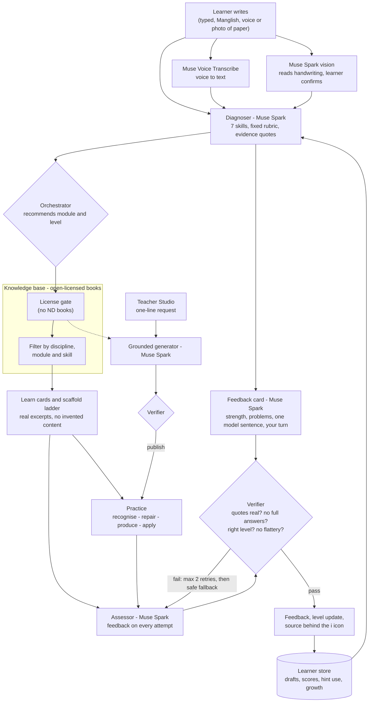

# VibeEduTwin Architecture

VibeEduTwin is an adaptive academic-writing practice loop for undergraduates from Malayalam and other vernacular-medium backgrounds. It is not a question-and-answer chatbot. Every session moves the learner through diagnose, learn, practise, assess and grow. All teaching content is grounded in open-licensed textbooks and checked by a Verifier before the learner sees it.

## System diagram

## Components

| Component | Role |
|---|---|
| Voice input | Muse Voice Transcribe turns spoken input into text, with a 20-second limit. The browser's built-in speech recognition is the fallback, and is used for Malayalam, which Meta does not list. |
| Scan my paper | Muse Spark vision transcribes a photo of a handwritten paragraph exactly as written, keeping the learner's own spelling. Unclear words are marked, and the learner confirms the text before diagnosis. The photo is not stored. |
| Language input | Learners can type in Malayalam, other Indian languages, Manglish or English. The twin replies in simple English and reflects the idea back first. |
| Diagnoser | Muse Spark scores a draft on 7 fixed skills (grammar, vocabulary, sentence structure, paragraphing, argument, using sources, academic tone) at levels 1 to 5. The rubric lives in code, so the model never invents criteria. Every score carries an exact quote from the learner's text, which code checks. The weakest skill is chosen in code. A cautious rule-based estimate is the fallback. |
| Feedback card | Muse Spark writes feedback on the learner's own paragraph: one real strength, the two main problems (quote, what, why, how to fix), one model sentence rewritten before → after, and a "your turn" prompt. |
| Twin voice | Template lines in a future-self voice, always specific to the learner's skill and progress. No model-generated twin chat as teaching content. |
| Orchestrator | Recommends the learner's next module and level, and decides level-ups (two practice sets in a row at 80% or more) and step-downs. All modules stay open; the recommended one is marked. |
| Knowledge base | ChromaDB with open-licensed academic writing books. Chunks are tagged with book, chapter, license, discipline and skill. |
| License gate | Excludes No-Derivatives (ND) books, so only reusable sources are chunked and shown. |
| Curriculum | 6 disciplines (Sciences, Technology, Medicine, Arts & Humanities, Commerce & Management, Social Sciences) × 9 modules: topic sentences, thesis statements, developing paragraphs, coherence and flow, using sources, mechanics, referencing styles (APA and MLA), academic vocabulary, and the discipline's own genre (lab report, technical report, case report, essay, business report, research report). Medicine covers writing genres only, never health advice. |
| Scaffold ladder | Productive struggle with Vygotskian scaffolding: the learner tries first and is assessed, then gets a guiding question about their own sentence, a targeted hint, a real book example, and finally rewrites; the rewrite is compared with the first try. "Show me now" offers worked steps on a different topic, followed by a self-explanation question. |
| Practice | Four item types: recognise, repair, produce, apply. Mixed review of earlier modules comes every third set. |
| Assessor | Gives feedback on every answer: one real strength, the main problem quoted from the learner's own words, and one next action. It points to errors without rewriting them, and asks questions instead of asserting facts. |
| Verifier | Checks every model output before the learner sees it: quotes exist in the learner's text, grounded in an excerpt, no complete answers, at most one sentence rewritten, right level, simple English, no generic praise, model examples on a different topic from the task. Each model call has a timeout, at most 2 retries, then a safe fallback. |
| Demo mode | `DEMO_MODE=true` gives a scripted, reliable path for the pre-seeded demo paragraphs. Any other text still uses live Muse Spark. |
| Learner store | SQLite with drafts, scores per skill, growth history and hint use. The twin compares each new draft with the previous one. |
| Teacher Studio | A teacher types one request. Muse Spark generates items from real excerpts only, the Verifier checks them, and the teacher publishes them to learners' Practice. |
| "How it decided" panel | A collapsible log of at most 6 lines per submission: step, agent, tool and result. |

## Meta tools used

- **Muse Spark** (Meta Model API): the Diagnoser, Write feedback card, Assessor, practice judging, Teacher Studio grounded generator, and handwriting scanning (vision), with JSON output.
- **Muse Voice Transcribe**: voice input.
- **Muse Code**: used as the builder, with a separate Muse Code session as a read-only reviewer.

## Honest limits

- Some PDF text extraction still has damaged words. Better extraction is planned.
- Retrieval is semantic search with metadata filters and keyword scoring. Full hybrid search and reranking are planned.
- Model-written Malayalam had spelling errors in testing, so the twin replies in simple English and accepts Malayalam and Manglish as input only.
- Malayalam voice depends on the browser fallback, because Malayalam is not on Muse Voice Transcribe's documented language list.
- When Muse Spark is slow, some features fall back to simpler template feedback.
